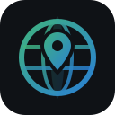
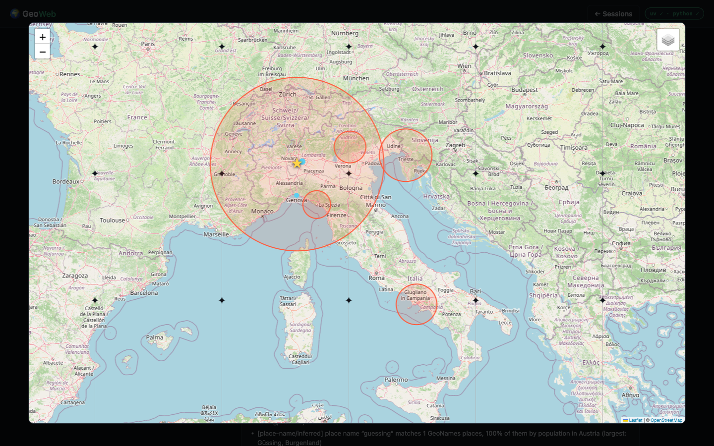
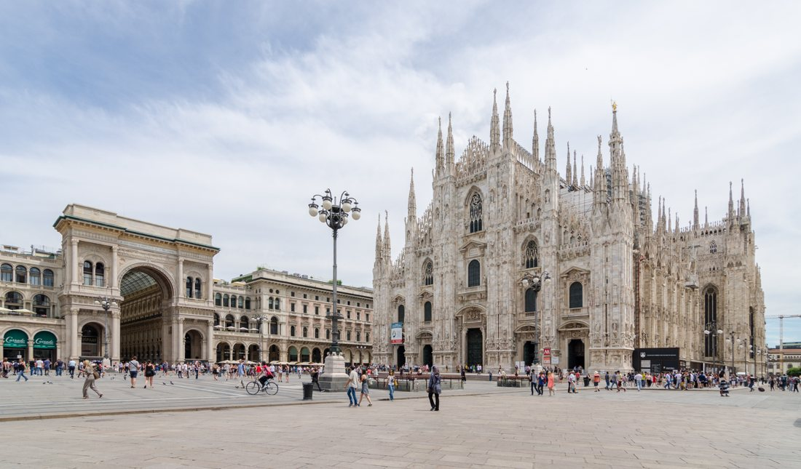
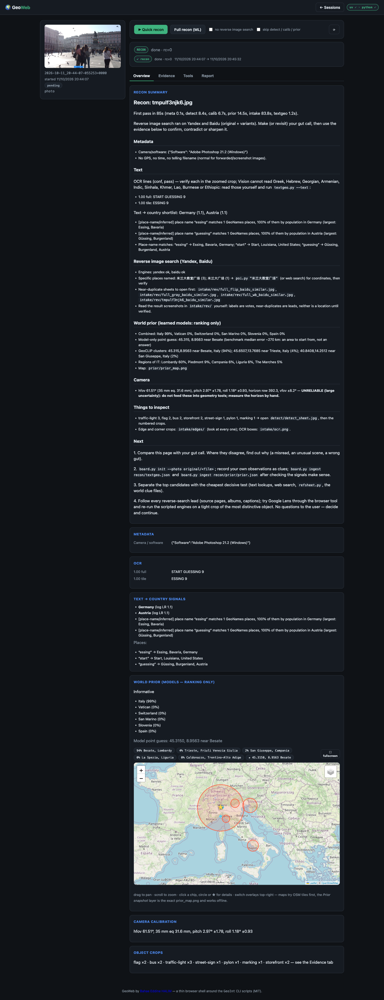
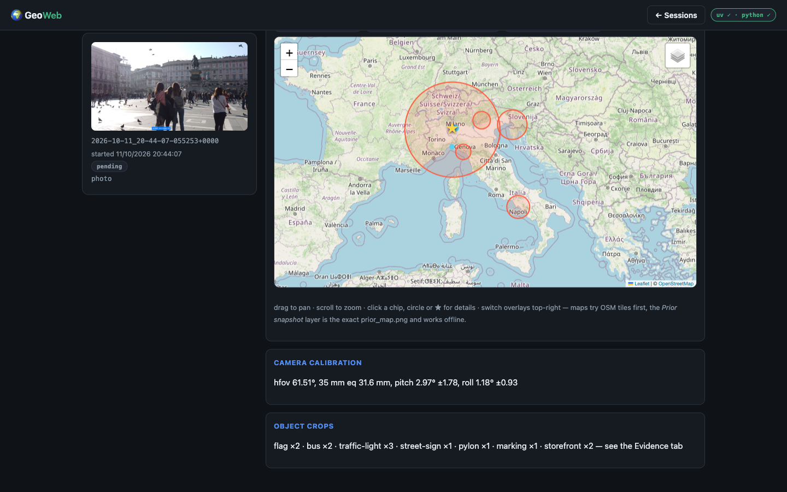
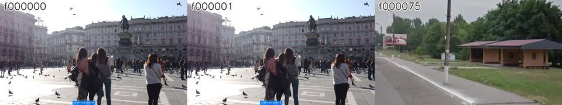
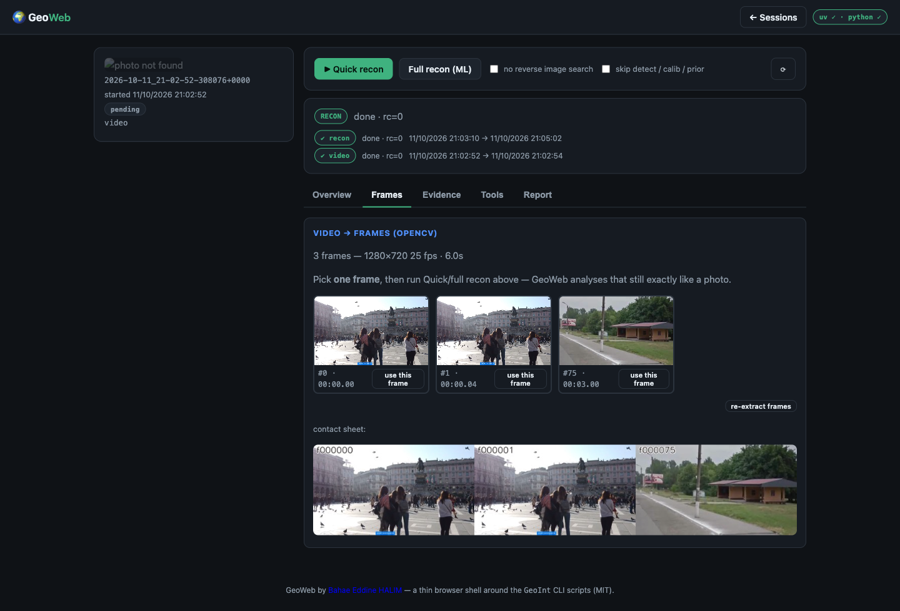

<!-- GeoWeb — Bahae Eddine HALIM <https://www.linkedin.com/in/halimbahae/> -->

# GeoWeb

**Find where any photo — or video — was taken, with the evidence in front of you.**

A local-first, open-source console for geolocation recon: metadata, OCR, reverse
image search, object detection, camera calibration and learned world priors, all
on your machine.

[Quickstart](#quickstart) · [Demos](#demos) · [Video](#videos) · [MCP](#mcp-server) · [API](docs/api.md) · [Docs](docs/index.md)

## Why

Most geolocation is either a black box or a pile of scripts you have to babysit.
GeoWeb keeps the **analyst in the loop**: it runs a real pipeline, shows you *why*
each candidate was raised — with plain-language caveats — and lets you make the
final call with the evidence in front of you.

Everything runs on your machine. Nothing is uploaded anywhere.

## Features

- 🗂 **Sessions as folders** — portable, diffable, backup-friendly archives.
- 🧭 **Full recon evidence** — EXIF, OCR text & signs, reverse-search
  near-duplicates (Yandex/Baidu), detector crops, horizon calibration, world prior.
- 🗺 **Interactive prior map** — OSM tiles or the exact prior snapshot, GeoCLIP
  clusters sized by mass, top points and the model's point guess. Fullscreen.
- 🎬 **Video** — OpenCV frame sampler (scene change + dHash dedupe) → contact
  sheet → recon runs on the frame you choose.
- 👀 **Live job bar** — steps land as they finish, each with a one-line digest;
  stop any job.
- 🧰 **Tools tab** — text→country, GeoNames, the reasoning board and a raw runner
  for every `scripts/*.py`.
- 🤖 **MCP server** — drive your archive from opencode, Claude Code, Codex, GitHub Copilot CLI, Grok CLI, Cursor or Claude Desktop.
- 🐳 **Docker** — one image, optional ML build.

## Quickstart

Requirements: **Python 3.10+** and **[uv](https://docs.astral.sh/uv/)** (steps
declare their own deps as PEP-723 headers). **ffmpeg** only for video. The server
itself needs no third-party packages.

<pre><code class="language-bash">git clone https://github.com/halimbahae/geoweb
cd geoweb
python3 web/app.py --open          # http://127.0.0.1:8787
</code></pre><button class="gw-copy">Copy</button>

Drop a photo, pick **Quick recon**, read the evidence. Your archive lives in
`~/geoweb-photos`:

<pre><code class="language-bash">python3 web/app.py --root /mnt/photos --port 8788 --host 0.0.0.0 --open
</code></pre><button class="gw-copy">Copy</button>

<strong>Docker</strong>

<pre><code class="language-bash">docker compose up --build                        # http://127.0.0.1:8787
docker compose build --build-arg BUILD_ML=1      # bake the world-prior models
</code></pre><button class="gw-copy">Copy</button>

## Demos

Seven demo sessions ship with the repo — **five photos and two real video clips** —
all freely licensed (Wikimedia Commons / Pexels) and GPS-stripped. Seed them into
your archive and run the full recon on each:

<pre><code class="language-bash">make demos                 # uv run demos/seed.py → ~/geoweb-photos, full recon
python3 demos/seed.py --recon quick   # fast pass, no ML models
</code></pre><button class="gw-copy">Copy</button>

| Session | Kind | Subject (answer key) | Licence |
| --- | --- | --- | --- |
| `demo-image-1` | 📷 | Milan Cathedral | CC BY-SA 4.0 |
| `demo-image-2` | 📷 | Colosseum, Rome | CC0 |
| `demo-image-3` | 📷 | Shibuya crossing, Tokyo | CC0 |
| `demo-image-4` | 📷 | Eiffel Tower, Paris | Public domain |
| `demo-image-5` | 📷 | Taj Mahal, Agra | CC BY-SA 4.0 |
| `demo-video-1` | 🎬 | Tokyo street at night (real footage) | Pexels Licence |
| `demo-video-2` | 🎬 | Colosseum in daylight (real footage) | Pexels Licence |

Session names are intentionally opaque (`demo-image-N` / `demo-video-N`) so
opening a demo doesn't spoil the answer. Sources and licences are itemised in
[`demos/README.md`](demos/README.md). The
walkthrough below uses the same archive. All evidence lives in each session's
`recon/` folder, and every session can be exported to **Markdown, HTML, PDF or
JSON** (branded) straight from the console's Report tab.

### 1 · Photo — a landmark, stripped of metadata

EXIF was washed by Photoshop, so metadata gives nothing. The pipeline leans on
reverse image search + text signals; the learned world prior adds a
**ranking-only** hint it flags as low-trust, and calibration reports a plausible
field of view — exactly the "here's the evidence, you decide" shape GeoWeb is
built for. On this run the prior landed **Italy 99% · near Milan**.

### 2 · Photo — dense text & objects

The Shibuya and Colosseum sessions exercise OCR (place names, shop signage) and
the detector (`bollard`, `sign`, `bus-stop`, `street-sign`), while reverse search
returns named places to verify. Text→country signals and the reasoning board
narrow the map.

### 3 · Video — real footage, reduced to the frames that matter

A short city clip is cut to a handful of **distinct frames** by scene change +
dHash dedupe, with a contact sheet on the session card. Picking the informative
frame and running recon gives the same evidence flow as a photo — and video
sessions now show their contact sheet instead of a "photo not found" tile.

## Videos

<pre><code class="language-bash"># in the console: drag a clip onto the dropzone
curl -sX POST http://127.0.0.1:8787/api/sessions -F photo=@clip.mp4
</code></pre><button class="gw-copy">Copy</button>

GeoWeb extracts representative frames, you choose one, and recon treats it like a
photo. See [docs/video-guide.md](docs/video-guide.md) for the sampler internals.

## MCP server

Give an AI assistant hands on the archive over the
[Model Context Protocol](https://modelcontextprotocol.io):

<pre><code class="language-bash">GEOWEB_ROOT=~/geoweb-photos uv run mcp/geoweb_mcp.py            # stdio
GEOWEB_ROOT=~/geoweb-photos uv run mcp/geoweb_mcp.py --transport sse --port 8989
</code></pre><button class="gw-copy">Copy</button>

Tools: `sessions`, `session`, `start_recon`, `recon_status`, `read_file`,
`frames`, `tools`. Copy-paste client configs for **opencode, Claude Code, Codex,
GitHub Copilot CLI, Grok CLI, Cursor, Claude Desktop, VS Code / Windsurf** are in
[`mcp/README.md`](mcp/README.md); this repo also ships an
[`opencode.json`](opencode.json) that wires it up automatically.

## Skill

This repo carries an agent [skill](skills/geoweb/SKILL.md) (plus
[`AGENTS.md`](AGENTS.md)) describing the layout, commands and rules — load it
when you ask an agent to work on GeoWeb.

## Architecture

<pre><code class="language-">browser ─► web/app.py  (stdlib HTTP: static console + JSON API + job runner)
                 │ uv run
                 ├─ scripts/*.py      vendored GeoINT engine (MIT)
                 └─ video/frames.py   OpenCV frame sampler
                          ▼
        ~/geoweb-photos/<session>/  original/ · recon/ · frames/ · report.md
</code></pre><button class="gw-copy">Copy</button>

Full write-up in [docs/architecture.md](docs/architecture.md); every HTTP
endpoint is documented in [docs/api.md](docs/api.md).

## Project layout

| Path | What |
| --- | --- |
| [`web/`](web) | stdlib server + no-build console (vendored Leaflet) |
| [`scripts/`](scripts) | vendored recon engine (from marouane53/GeoINT, MIT — see [NOTICE](NOTICE)) |
| [`video/`](video) | OpenCV frame sampler |
| [`mcp/`](mcp) | Model Context Protocol server |
| [`landing/`](landing) | this GitHub Pages site |
| [`docs/`](docs) | quickstart, guides, API, architecture, deployment |
| [`skills/`](skills) · [`AGENTS.md`](AGENTS.md) | agent guidance |

<pre><code class="language-bash">make serve   # run the console      make test   # pytest
make lint    # ruff                 make ci     # ruff + pytest + py_compile + node --check
make docker  # build the image      make video  # cut a video into frames
</code></pre><button class="gw-copy">Copy</button>

## License & attribution

GeoWeb is **MIT** licensed ([LICENSE](LICENSE)). The recon engine under
`scripts/` is vendored from the MIT-licensed
[marouane53/GeoINT](https://github.com/marouane53/GeoINT) project; attribution is
in [NOTICE](NOTICE). Some optional learned models are licensed for
non-commercial use — check before commercial deployment.

Built by **Bahae Eddine HALIM** — <https://www.linkedin.com/in/halimbahae/>

